<!--
Presentación Marp basada en CODEBOT.html.
Mantener CODEBOT.marp.assets/ junto a este archivo: contiene SVG autónomos,
los 13 originales y vistas de detalle de FSM, entidades y secuencia.

Render HTML: marp CODEBOT.marp.md --html -o CODEBOT.slides.html
Export PDF: marp CODEBOT.marp.md --html --allow-local-files --pdf -o CODEBOT.slides.pdf
En VS Code con Marp habilitar HTML para las tarjetas y diagramas.

Validación de referencia: render Marp Core en Chrome, 1280 × 720,
43 slides sin overflow detectado; revisión visual de todas las slides.
-->

<!-- _class: cover -->
<!-- _paginate: false -->

<div class="eyebrow">Sistema de ingeniería autónoma</div>

# CODEBOT<span style="color:#77baff">.</span>

<div class="subtitle">Del backlog a una PR verificable.<br>Arquitectura, funcionamiento y recuperación persistente.</div>

<div><span class="pill">Python + Docker</span><span class="pill">Claude / OpenCode</span><span class="pill">OpenSpec + Superpowers</span><span class="pill">Slack / Email</span></div>

<div class="caption">Basado en CODEBOT.html y el código al 09.10.2026, incluida la recuperación de evidencia de 933a742. No certifica la versión desplegada en Azure.</div>

---

<div class="eyebrow">01 / Visión del proyecto</div>

## El agente trabaja. El controlador decide.

<div class="cards">
<div class="card"><h3>Codebot</h3><p>Supervisa fases, pruebas y resultados. Posee el estado de ejecución, las transiciones y la publicación.</p></div>
<div class="card purple"><h3>Agente</h3><p>Explora, propone, implementa, diagnostica y revisa. Produce código, commits locales y contratos.</p></div>
<div class="card amber"><h3>Persona</h3><p>Aprueba el acuerdo de trabajo, resuelve decisiones materiales y autoriza el merge de la PR.</p></div>
</div>

<div class="callout">No es una sesión de chat que «hace todo»: es un <strong>supervisor persistente de ingeniería</strong>.</div>

---

<div class="eyebrow">02 / Mapa de la presentación</div>

## Tres perspectivas de un mismo sistema

<div class="cards">
<div class="card"><h3>Estructura</h3><p>Componentes, entidades, adaptadores, runtime y supervisores auxiliares.</p></div>
<div class="card purple"><h3>Ejecución</h3><p>OpenSpec, Superpowers, ciclo de tarea, FSM y flujo dinámico.</p></div>
<div class="card amber"><h3>Confianza</h3><p>Decisiones, checks reales, evidencia, recibos y recuperación.</p></div>
</div>


---

<!-- _class: diagram -->
<div class="eyebrow">03 / Arquitectura de componentes</div>

## Integraciones intercambiables, un controlador central

<div class="diagram-frame">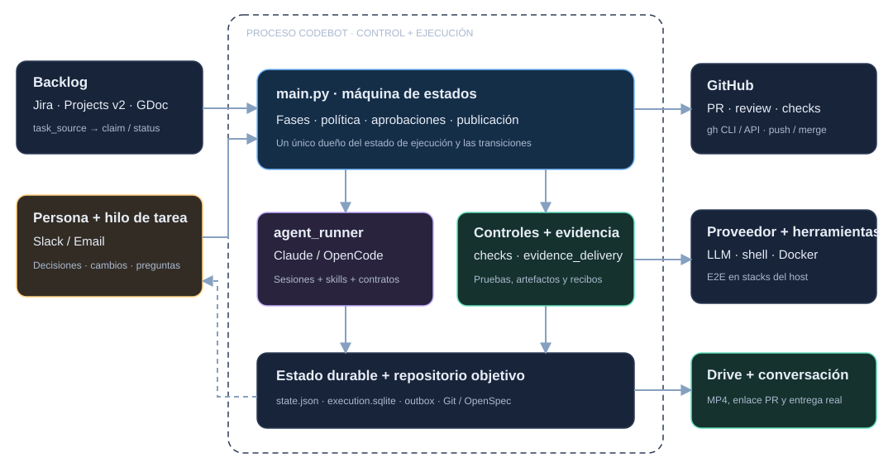</div>
<div class="caption">La fuente de tareas, el canal de conversación y el agente se eligen de forma independiente.</div>

---

## Qué entra y qué sale de Codebot

<div class="cards two">
<div class="card"><h3>Entrada de trabajo</h3><p>Ticket o issue, detalles e imágenes; contexto técnico y decisiones del mismo hilo.</p><p>Claims y holds usan identidad de instancia y fingerprint persistentes.</p></div>
<div class="card"><h3>Salida verificable</h3><p>Propuesta, implementación, resultados reales, PR, vídeo o reporte y confirmaciones de entrega.</p><p>El backlog conserva actividad y el enlace a la PR.</p></div>
</div>

<div class="caption">Codebot vive en su propio repositorio y trabaja sobre el checkout indicado por CODEBOT_REPO_PATH.</div>

---

<div class="eyebrow">04 / OpenSpec + Superpowers</div>

## Acuerdo, método y autoridad

<div class="cards">
<div class="card"><h3>OpenSpec</h3><p><strong>Qué construir y por qué.</strong></p><p>Requisitos, diseño y tareas inspeccionables; contexto que sobrevive a una sesión.</p></div>
<div class="card purple"><h3>Superpowers</h3><p><strong>Cómo construirlo.</strong></p><p>Brainstorming, TDD, diagnóstico sistemático y revisión independiente.</p></div>
<div class="card amber"><h3>Codebot</h3><p><strong>Cuándo avanzar.</strong></p><p>Fases, aprobación, gates, checks, archivo, push, PR y merge.</p></div>
</div>

---

<!-- _class: diagram -->
## OpenSpec y Superpowers no son controladores rivales

<div class="diagram-frame">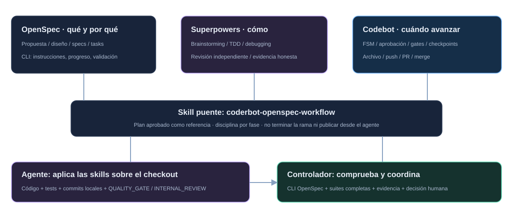</div>
<div class="caption">La skill coderbot-openspec-workflow mantiene la frontera entre disciplina de ingeniería y autoridad de orquestación.</div>

---

## OpenSpec conserva el acuerdo aprobado

```text
openspec/
├── changes/<slug>/
│   ├── proposal.md       Motivación y alcance
│   ├── design.md         Diseño técnico y riesgos
│   ├── specs/…/spec.md   Requisitos y escenarios
│   └── tasks.md          Checklist de trabajo
├── specs/…/spec.md       Especificaciones consolidadas
└── changes/archive/…/   Historia del cambio
```

<div class="callout">Cambiar checkmarks no es cambiar alcance. Añadir o quitar tareas puede requerir una <strong>nueva decisión de producto</strong>.</div>

---

## Superpowers influye en cada fase de ingeniería

<div class="cards two">
<div class="card purple"><h3>Explorar e implementar</h3><p><code>brainstorming</code>: opciones, riesgos y diseño simple.</p><p><code>test-driven-development</code>: prueba RED, implementación GREEN y evidencia honesta.</p></div>
<div class="card purple"><h3>Diagnosticar y revisar</h3><p><code>systematic-debugging</code>: causa antes de editar.</p><p><code>requesting-code-review</code>: revisor fresco, corrección de hallazgos y re-review.</p></div>
</div>

<div class="caption">Invocar una skill no demuestra cumplimiento. Los comandos, resultados y controles reales siguen siendo necesarios.</div>

---

## De las skills a las puertas del controlador

<div class="cards two">
<div class="card"><h3>Integración gestionada</h3><p>La imagen fija OpenSpec 1.9.0 y Superpowers v6.3.0.</p><p>Genera skills para Claude y OpenCode; los runners cargan plugins y rutas gestionadas.</p></div>
<div class="card"><h3>Verificación independiente</h3><p>Codebot valida el cambio, consulta progreso CLI y contrasta checklist con QUALITY_GATE.</p><p>El controlador archiva, valida specs, hace push y abre la PR.</p></div>
</div>

<div class="callout">Ni OpenSpec ni Superpowers autorizan publicación por sí solos. El agente <strong>devuelve control</strong> al supervisor.</div>

---

<!-- _class: diagram -->
<div class="eyebrow">05 / Ciclo de vida</div>

## Una tarea avanza mediante puertas explícitas

<div class="diagram-frame">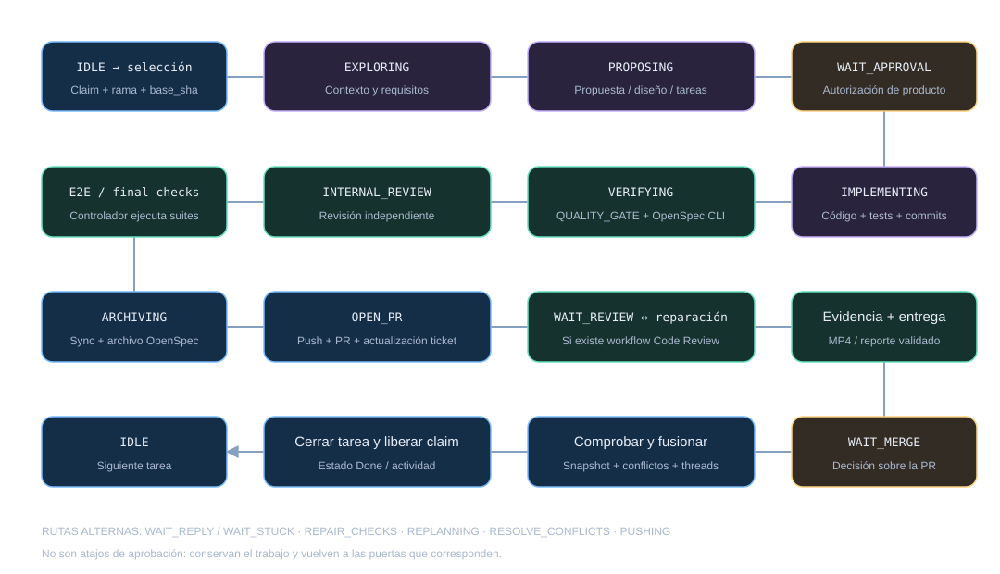</div>
<div class="caption">Preguntas, revisión, reparación y conflictos son rutas de retorno, no atajos de aprobación.</div>

---

## Las fronteras que no se deben confundir

<div class="cards two">
<div class="card amber"><h3>Propuesta → código</h3><p>Hace falta autorización de la versión del acuerdo. Una aclaración o un «continúa» ambiguo no bastan.</p></div>
<div class="card"><h3>Código → PR</h3><p>Checklist completo, calidad, revisión interna y controles del controlador.</p></div>
<div class="card"><h3>PR → lista para revisar</h3><p>Evidencia actual y entregable. Si hay harness, no se anuncia éxito con cero vídeos.</p></div>
<div class="card amber"><h3>Decisión → merge</h3><p>Estado, snapshot revisado, conflictos y threads; autorización humana inequívoca.</p></div>
</div>

---

<div class="eyebrow">06 / Estados de la FSM</div>

## 24 estados registrados; retornos por contexto

<div class="cards">
<div class="card"><h3>18 fases</h3><p>Trabajo, revisión, recuperación y publicación despachados por PHASES.</p></div>
<div class="card amber"><h3>6 esperas</h3><p>Aprobación, merge, respuesta, bloqueo, checkout limpio y review externa.</p></div>
<div class="card"><h3>Contexto durable</h3><p>return_state, stuck_return y push_context determinan la continuación.</p></div>
</div>

<div class="caption">HOLD guarda una tarea aparcada; no es un estado del dispatch. FEEDBACK_QUESTION es una continuación, no una fase registrada.</div>

---

<!-- _class: diagram -->
## FSM · Camino principal y guardas

<div class="diagram-frame">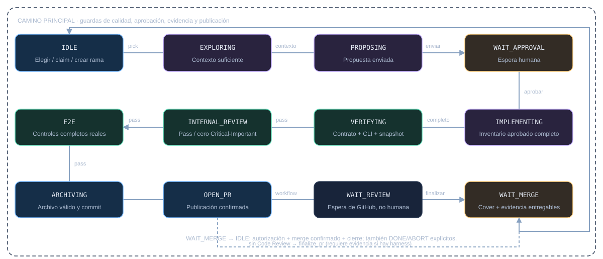</div>
<div class="caption">VERIFYING puede reutilizar una revisión vigente del mismo snapshot; ausencia de Code Review omite solo la espera externa.</div>

---

<!-- _class: diagram -->
## FSM · Review, conflictos y publicación

<div class="diagram-frame">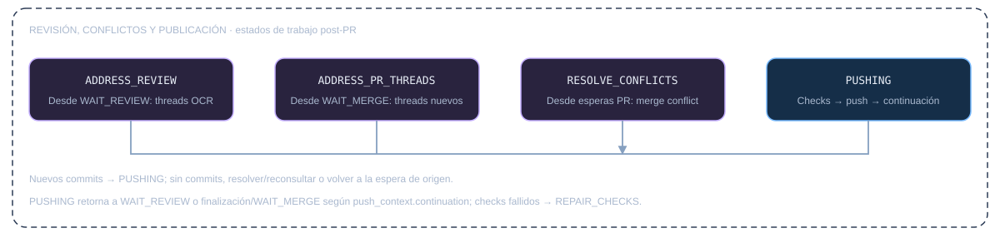</div>
<div class="caption">PUSHING conserva output, adjuntos y continuación; un push fallido no debe repetir el turno de reparación del agente.</div>

---

<!-- _class: diagram -->
## FSM · Reparación y cambios de alcance

<div class="diagram-frame">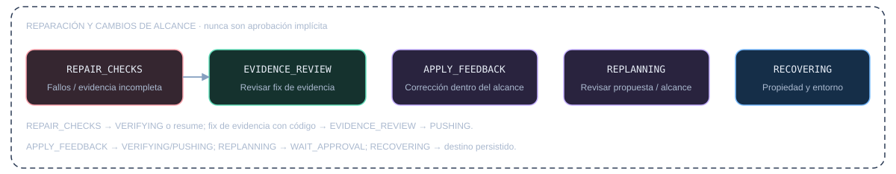</div>
<div class="caption">Corrección dentro del alcance ≠ replanning. La reparación de evidencia modificada exige revisión y controles antes de publicar.</div>

---

<!-- _class: diagram -->
## FSM · Esperas y retorno seguro

<div class="diagram-frame">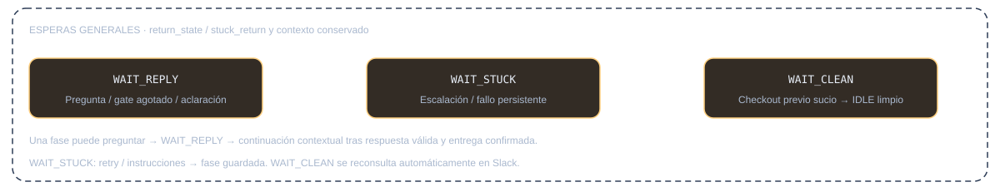</div>
<div class="caption">Los límites agotados mantienen el trabajo bloqueado y presentan opciones concretas; no inventan un gate pass.</div>

---

<!-- _class: diagram -->
<div class="eyebrow">07 / Entidades y responsabilidades</div>

## Estructura del sistema · Identidad y ejecución

<div class="diagram-frame">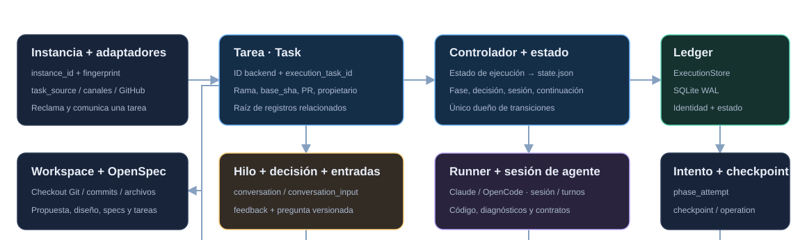</div>
<div class="caption">La tarea agrupa intentos y resultados por task_id. El estado de ejecución vive en state.json; no todo objeto es una tabla.</div>

---

<!-- _class: diagram -->
## Estructura del sistema · Resultados y entrega

<div class="diagram-frame">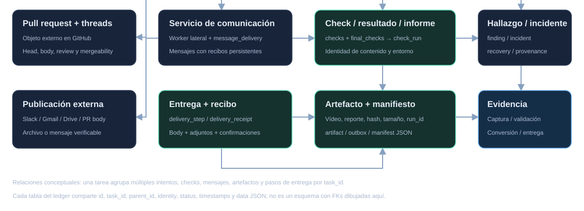</div>
<div class="caption">Relaciones conceptuales, no un esquema ER literal. Los registros SQLite comparten identidad, estado y data JSON.</div>

---

<!-- _class: diagram -->
<div class="eyebrow">08 / Flujo dinámico</div>

## Secuencia · Del ticket al acuerdo aprobado

<div class="diagram-frame">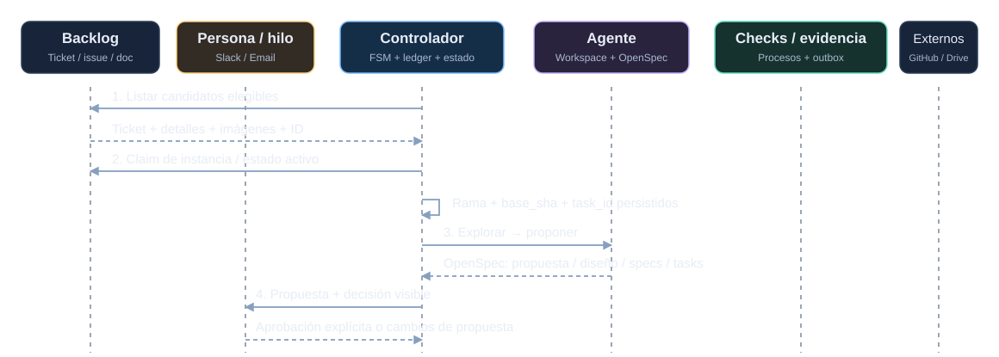</div>
<div class="caption">El tiempo avanza hacia abajo. Flechas punteadas: resultados y confirmaciones, no nuevas órdenes.</div>

---

<!-- _class: diagram -->
## Secuencia · De la implementación a la evidencia

<div class="diagram-frame">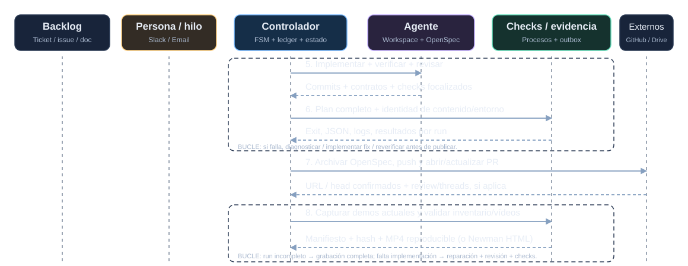</div>
<div class="caption">Los fallos agregan ciclos de diagnóstico, implementación y revalidación antes de publicar resultados.</div>

---

<!-- _class: diagram -->
## Secuencia · Publicación, decisión y cierre

<div class="diagram-frame">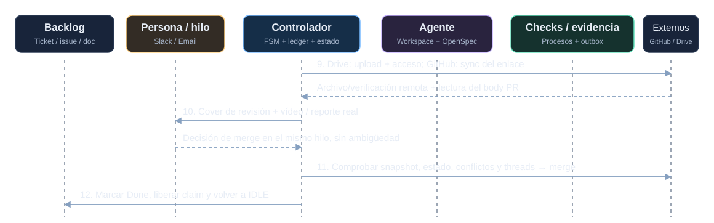</div>
<div class="caption">Flujo de datos y flujo de control son distintos: recibir un vídeo o pedir su publicación no autoriza merge.</div>

---

<!-- _class: diagram -->
<div class="eyebrow">09 / Conversación</div>

## Conversar no debe secuestrar el workflow

<div class="diagram-frame">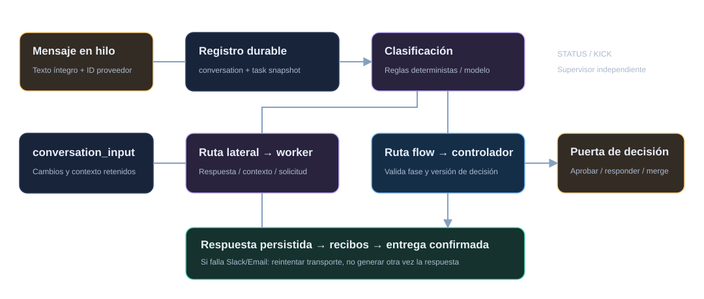</div>
<div class="caption">El worker lateral puede responder y registrar contexto; solo el controlador consume instrucciones que cambian la FSM.</div>

---

## Decisiones versionadas, respuestas completas

<div class="cards two">
<div class="card amber"><h3>No inferir autorización</h3><p>Se consideran texto íntegro, condiciones y negaciones.</p><p>Una selección antigua no autoriza una nueva pregunta. /btw siempre es lateral.</p></div>
<div class="card"><h3>No perder respuestas</h3><p>La respuesta y su continuación se guardan antes de entregar.</p><p>Si falla Slack/Email, reintentar transporte; no volver a generar el mismo resultado.</p></div>
</div>

<div class="caption">NEED_USER_INPUT pausa con opciones visibles y fase de retorno conservada. Solicitar evidencia no cambia una decisión de producto pendiente.</div>

---

<!-- _class: diagram -->
<div class="eyebrow">10 / Verificación</div>

## La prueba no es el resumen del agente

<div class="diagram-frame">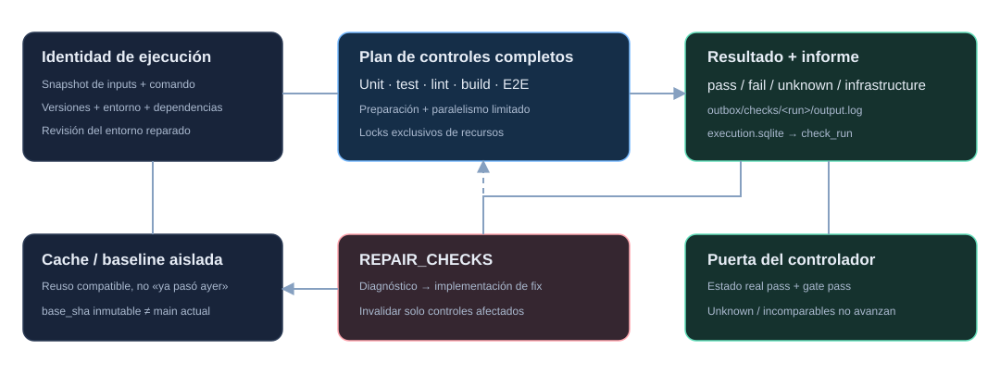</div>
<div class="caption">La política actual exige estado real pass y gate pass. Una baseline atribuye fallos; no convierte tests fallidos en éxito.</div>

---

## Checks reutilizables, pero nunca obsoletos

<div class="cards two">
<div class="card"><h3>Identidad conservadora</h3><p>Inputs de contenido + comando + herramientas + dependencias + entorno.</p><p>Reusar por «ya pasó ayer» no prueba la versión integrada.</p></div>
<div class="card"><h3>Reparación autónoma</h3><p>Diagnosticar logs reales y corregir código, tests, intérprete, dependencias o servicios.</p><p>Invalidar checks afectados; reusar solo resultados vigentes.</p></div>
</div>

<div class="callout">Unknown, infraestructura y timeout <strong>no pasan</strong> por una afirmación del agente ni por «ignóralo».</div>

---

<!-- _class: diagram -->
<div class="eyebrow">11 / Evidencia</div>

## Un WebM existente todavía no es evidencia entregada

<div class="diagram-frame">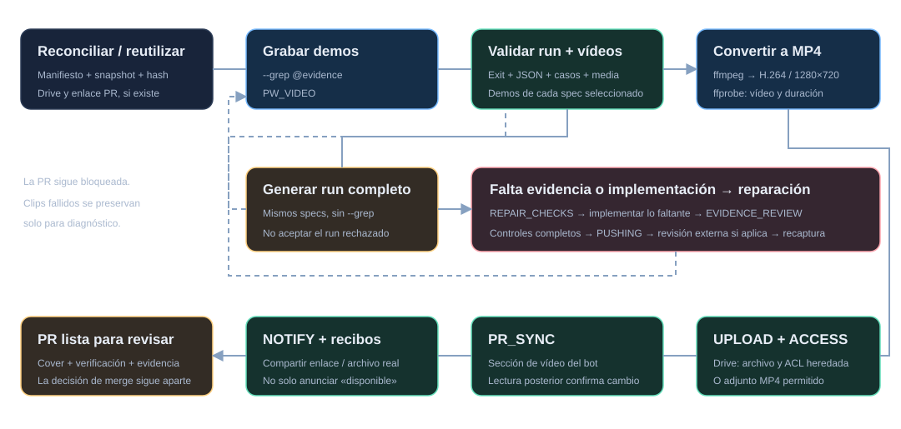</div>
<div class="caption">Playwright produce vídeo UI; Newman puede producir un reporte API. Artefactos en outbox, no en Git del producto.</div>

---

## Si falta evidencia, producirla o implementar el fix

<div class="cards two">
<div class="card amber"><h3>Run filtrado rechazado</h3><p>Generar los specs completos con vídeo y validar el nuevo run.</p><p>No aceptar el exit fallido ni mezclar clips rechazados con evidencia aprobada.</p></div>
<div class="card purple"><h3>Implementación incompleta</h3><p>Crear demos, soporte de grabación o funcionalidad faltante dentro del alcance.</p><p>Revisión, controles y recaptura antes de anunciar la PR como lista.</p></div>
</div>

<div class="callout">No es una salida admisible: <strong>«vídeos inválidos; entrego cero adjuntos»</strong>.</div>

---

## Captura válida y publicación válida son puertas distintas

<div class="cards two">
<div class="card"><h3>Procedencia + media</h3><p>Run actual, JSON aprobado, inventario completo, vídeos únicos, hash y snapshot.</p><p>MP4 reproducible: duración y stream de vídeo comprobados con ffprobe.</p></div>
<div class="card"><h3>Entrega confirmada</h3><p>Drive verifica archivo y acceso heredado; no crea acceso público.</p><p>PR_SYNC conserva el body ajeno; lectura posterior confirma el enlace. Recibos confirman mensaje y adjuntos.</p></div>
</div>

<div class="caption">Si falla el upload o PR_SYNC, se reusa el MP4 válido; no se regraba por un fallo exclusivamente de transporte.</div>

---

<!-- _class: diagram -->
<div class="eyebrow">12 / Recuperación</div>

## Estado de ejecución, ledger y Git cumplen funciones distintas

<div class="diagram-frame">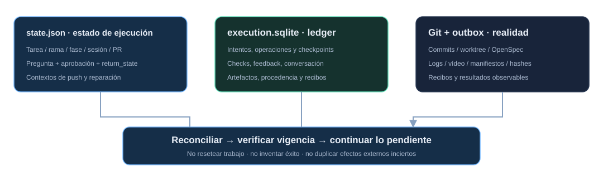</div>
<div class="caption">No resetear trabajo. No inventar éxito. No duplicar efectos externos inciertos.</div>

---

## Recuperar no significa empezar otra vez

<div class="cards two">
<div class="card"><h3>Sesión o proceso interrumpidos</h3><p>Reconstruir contexto desde Git, OpenSpec y checkpoints; conservar trabajo válido.</p><p>KICK cancela el turno, no cambia alcance ni descarta archivos.</p></div>
<div class="card"><h3>Entrega parcial</h3><p>Reconciliar recibos y reintentar solo lo no confirmado.</p><p>SQLite y APIs externas no forman una transacción: hay incertidumbre, no exactly-once universal.</p></div>
</div>

<div class="callout">Conservar <strong>state.json, SQLite, Git, manifiestos y media</strong>. No borrar historia para «forzar retry».</div>

---

<!-- _class: diagram -->
<div class="eyebrow">13 / Runtime</div>

## Un supervisor en Docker, stacks E2E en el host

<div class="diagram-frame">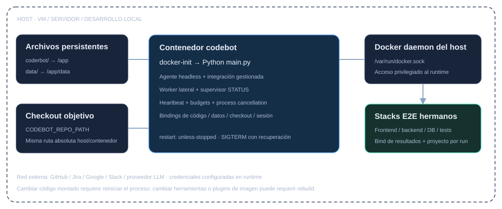</div>
<div class="caption">CODEBOT_REPO_PATH conserva la misma ruta absoluta host/contenedor; el socket apunta al daemon del host.</div>

---

## Autonomía operativa no equivale a sandbox

<div class="cards two">
<div class="card amber"><h3>Runtime confiable y privilegiado</h3><p>Docker socket, Git, herramientas y proveedor tienen acceso configurado.</p><p>No ejecutar tareas no confiables suponiendo aislamiento OS fuerte.</p></div>
<div class="card"><h3>Presupuestos explícitos</h3><p>Agente 1.800 s; E2E 900 s; tool local 200 s.</p><p>Subagente 600 s; proveedor 180 s; utilidad 30 s. Límites configurables y acotados por presupuesto padre.</p></div>
</div>

<div class="caption">Proteger .env, tokens, sesiones y datos. Reiniciar para aplicar configuración; cambios de toolchain pueden requerir rebuild.</div>

---

<!-- _class: diagram -->
<div class="eyebrow">14 / Supervisores auxiliares</div>

## Quién observa al proceso principal

<div class="diagram-frame">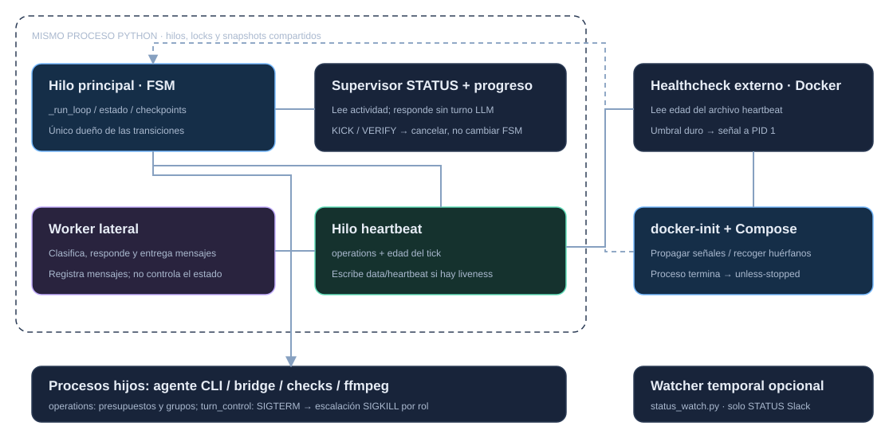</div>
<div class="caption">Los hilos internos no son servicios independientes. La capa Docker puede detectar una señal obsoleta aunque Python deje de progresar.</div>

---

## Supervisión interna y externa tienen límites diferentes

<div class="cards two">
<div class="card"><h3>Dentro de Python</h3><p>STATUS y progreso: snapshots y comandos sin turno LLM; no mutan la FSM.</p><p>Heartbeat: renueva solo con liveness válida. Worker lateral: conversación, no watchdog.</p></div>
<div class="card"><h3>Fuera del hilo principal</h3><p>Healthcheck Docker: edad de heartbeat; umbral duro fuerza salida y restart.</p><p>docker-init propaga señales y recoge huérfanos. status_watch.py es fallback opcional de STATUS Slack.</p></div>
</div>

<div class="caption">Unhealthy no provoca restart por sí solo. operations y turn_control acotan procesos y cancelan grupos con SIGTERM/SIGKILL.</div>

---

<!-- _class: diagram -->
<div class="eyebrow">15 / Arquitectura de integración</div>

## Project Management y Communication son independientes

<div class="diagram-frame">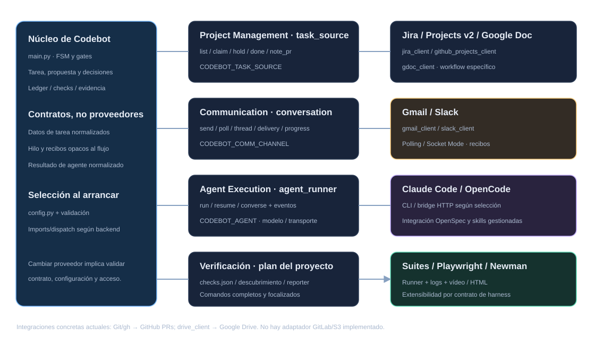</div>
<div class="caption">Puertos y adaptadores mediante funciones/dispatch Python; no un framework universal de plugins para todas las APIs.</div>

---

## Contratos comunes, capacidades diferentes

<div class="cards">
<div class="card"><h3>task_source.py</h3><p>Jira / Projects v2 / GDoc.</p><p>Listar, claim, hold, done, activity y enlazar PR. Normaliza intención, no workflows idénticos.</p></div>
<div class="card amber"><h3>conversation.py</h3><p>Gmail / Slack.</p><p>Hilos, polling/eventos, envío, límites y recibos. Progreso editable es opcional.</p></div>
<div class="card purple"><h3>agent_runner.py</h3><p>Claude / OpenCode.</p><p>Run, resume, eventos, cancelación, contexto y resultado normalizado.</p></div>
</div>

<div class="caption">main.py importa conversation como gmail_client por compatibilidad histórica; ese alias no obliga a usar email.</div>

---

## Extender sin acoplar la FSM al proveedor

<div class="cards two">
<div class="card"><h3>Implementar un adaptador</h3><p>Contrato, selección, configuración y validación. Probar identidad, autorización, recuperación y efectos externos.</p><p>El backend traduce sus estados y capacidades; la FSM conserva su política.</p></div>
<div class="card amber"><h3>Lo que no está implementado</h3><p>GitHub/gh y Google Drive son integraciones concretas de código y publicación.</p><p>GitLab o S3 requieren diseñar un puerto nuevo; no aparecen por cambiar una variable.</p></div>
</div>

<div class="caption">Combinaciones existentes: jira + slack + opencode; github + email + claude; gdoc + slack + claude.</div>

---

<div class="eyebrow">16 / Operación</div>

## Comandos: preguntar, interrumpir y decidir no son lo mismo

<div class="cards two">
<div class="card"><h3>Observar y controlar trabajo</h3><p><code>STATUS</code>: actividad y siguiente acción.</p><p><code>KICK</code>: cancelar turno y retomar.</p><p><code>HOLD / CONTINUE</code>: aparcar y reanudar.</p></div>
<div class="card amber"><h3>Puertas explícitas</h3><p><code>VERIFY</code>: verificar tarea existente; no autoriza publicación.</p><p><code>merge</code>: decisión de PR con gates.</p><p><code>ABORT / DONE</code>: abandonar o cerrar; no simular merge.</p></div>
</div>

---

## Diagnosticar desde la evidencia, no desde el resumen

1. Identificar instancia, tarea, hilo, rama, PR y fase.
2. Leer transición y resultado del **controlador**.
3. Consultar logs y JSON del **mismo run**.
4. Comparar exit code, inventario y artefactos actuales.
5. Distinguir código, infraestructura, conversión, acceso y transporte.

<div class="callout">«E2E pasó» y «la grabación posterior falló» pueden ser ciertos a la vez: <strong>son ejecuciones y puertas diferentes</strong>.</div>

---

<!-- _class: compact -->
<div class="eyebrow">17 / Mapa del código</div>

## Dónde mantener el núcleo y sus integraciones

<div class="cards two">
<div class="card"><h3>Orquestación y agentes</h3><p>main.py · config.py · task_phases.py</p><p>agent_runner.py · claude_runner.py · prompts.py · agent-plugin/</p></div>
<div class="card"><h3>Backlog y conversación</h3><p>task_source.py · jira_client.py · github_projects_client.py · gdoc_client.py</p><p>conversation.py · gmail_client.py · slack_client.py · feedback.py · handoffs.py</p></div>
<div class="card"><h3>Checks y evidencia</h3><p>check_plan.py · checks.py · final_checks.py · check_baseline.py · check_repair.py</p><p>evidence.py · evidence_delivery.py · drive_client.py</p></div>
<div class="card"><h3>Persistencia y runtime</h3><p>execution_store.py · execution_identity.py · phase_checkpoint.py · delivery_checkpoint.py</p><p>operations.py · turn_control.py · scripts/ · Dockerfile · Compose</p></div>
</div>

---

## Contratos de agente; no órdenes arbitrarias

<div class="cards two">
<div class="card purple"><h3>Preguntas y calidad</h3><p><code>NEED_USER_INPUT:</code> pregunta y espera.</p><p><code>QUALITY_GATE:</code> calidad a validar.</p><p><code>INTERNAL_REVIEW:</code> revisión limpia.</p></div>
<div class="card"><h3>Evidencia y review</h3><p><code>E2E_SPEC:</code> specs de evidencia.</p><p><code>ATTACH:</code> artefactos autorizados.</p><p><code>RESOLVE:</code> threads tratados.</p></div>
</div>

<div class="caption">Los marcadores son interfaces verificadas. Su presencia no prueba éxito ni concede autoridad de publicación.</div>

---

<!-- _class: cover -->

<div class="eyebrow">Principio rector</div>

## Conservar trabajo.<br>Verificar resultados.<br>Mantener la autoridad explícita.

<div class="cards">
<div class="card"><h3>Acuerdo</h3><p>OpenSpec conserva lo aprobado.</p></div>
<div class="card purple"><h3>Disciplina</h3><p>Superpowers orienta al agente.</p></div>
<div class="card amber"><h3>Control</h3><p>Codebot supervisa; la persona decide.</p></div>
</div>

<div class="caption">El acuerdo guía el trabajo; la evidencia respalda los resultados; las decisiones humanas autorizan las acciones.</div>
